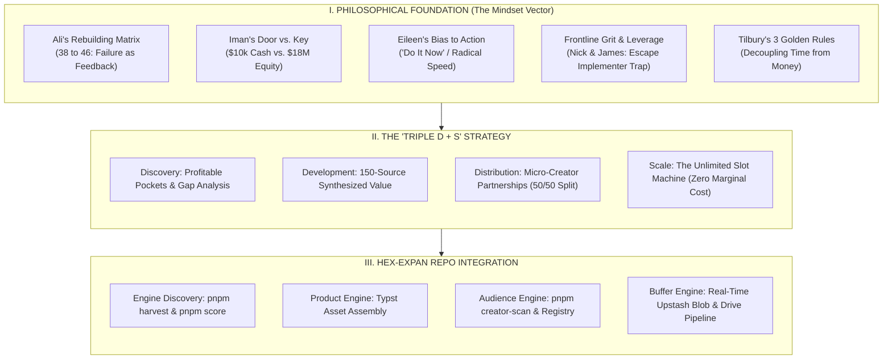
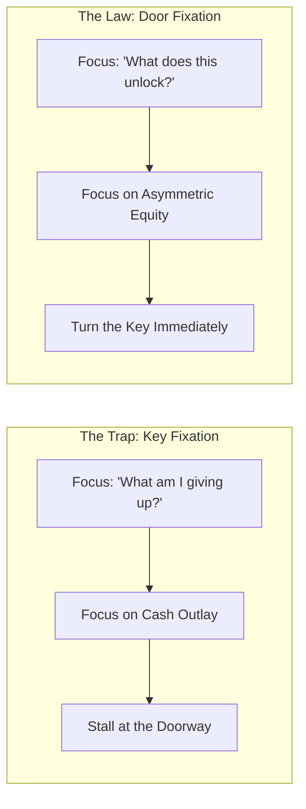
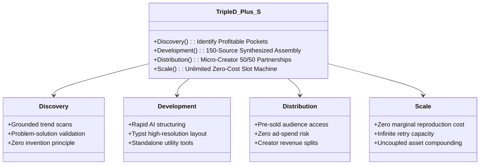

# THE NUGGETS OPERATING SYSTEM: DAYS 1–3 STRATEGIC SYNTHESIS
**From Philosophy to Asymmetric Execution: The Executive Playbook**  
*Document Version: 1.0.0 | Date: 2026-11-09 | Source Engine: Gadzhi AI Income Challenge (Days 1–3)*  
*Transcripts Verified: `day1_transcript_accurate_1s.md`, `day2_transcript_accurate_1s.md`, `day3_transcript_accurate_1s.md`*

---

## 1. Executive Overview: The "Triple D + S" Architecture

Across the first three days of the AI Income Challenge, the curriculum establishes an integrated, non-linear wealth generation engine. While technical tutorials demonstrate software mechanics, the true structural value resides in the **unfiltered personal testimonies, crisis lessons, and strategic mental models** delivered during the live broadcasts and after-hours sessions.

This document synthesizes these insights into an actionable operating system structured around four interconnected pillars:

---

## 2. Philosophy: The High-Leverage Mental Frameworks

### 2.1 Ali’s Rebuilding Matrix: From $15 at Age 38 to 8-Figure Masterminds at 46
*Source Timestamp: `day2_transcript_accurate_1s.md` [04:05:28] – [04:15:23]*

#### The Crucible
- **The Initial Trap:** Graduated university with $70,000–$80,000 in debt and zero employment prospects. Swallowed pride and sold mobile phones in a shopping centre on minimum wage.
- **The Betrayal:** Built a legal services side hustle to initial profitability ($30,000–$40,000 in bank reserves). Brought his best friend into the company, trained him, and granted him total financial and operational access.
- **The Collapse:** One morning at age 38, Ali arrived at the office to discover his best friend had systematically drained the bank account. He was left with **$15.00**, a repossessed car, crushing debt, and had to ask his parents for $15 just to buy food.
- **The Interim Government Reset:** Spent years in an IT consulting government role to survive, fighting chronic imposter syndrome and depressive inertia. Refused to abandon the search for an asymmetric vehicle, rejecting retail trading and dropshipping as high-risk, low-leverage gambles.

#### The Inflection Vector
- **The Monday/Wednesday Pivot:** Saw an announcement from Iman Gadzhi for digital product creators. Despite having zero formal credentials, he stepped into an empty side room in his government office during lunch break, recorded a raw, unedited application video on his phone, and sent it on Monday. By Wednesday, he was hired as an entry-level community representative.
- **Outworking Imposter Syndrome:** Surrounded by elite 7- and 8-figure operators whose vocabulary he didn't understand, Ali outworked everyone on execution, mastering community management and client consulting.
- **The 8-Year Ascension:** By age 46, Ali emerged as the core consulting director hosting global masterminds with top-tier entrepreneurs worldwide.

> **The Core Law of Ali's Rebuild:**  
> *"Failure is just feedback. Who gives a shit if you failed before? Life is about the opportunity and the vehicle you choose. You have a finite amount of time and energy on this earth—if you apply it to the wrong vehicle, you lose. Apply it to the right vehicle, and one decision erases a decade of hardship."*

---

### 2.2 Iman Gadzhi’s "Door vs. Key" Asymmetry: $10k Cash vs. $18M Equity
*Source Timestamp: `day2_transcript_accurate_1s.md` [04:25:00] – [04:45:00]*

#### The $18,000,000 Blind Spot
- Early in his career, an enterprise CEO offered Iman a binary fork:
  1. **Option A:** A secure cash salary ($10,000/month guaranteed).
  2. **Option B:** A small equity stake (shares) in the growing enterprise.
- Iman was gripped by the question that traps 99% of people: *"What am I giving up right now? What cash am I leaving on the table?"* Cash represented immediate safety, so he chose Option A.
- **The Cost:** Within five years, that equity stake was valued at **$18,000,000**.
- **The Realization:** He did not lose $18M because he lacked intelligence; he lost it because his mental aperture was locked onto the immediate cost rather than future asset value.

#### The Anatomy of the Door vs. the Key
- **The Key:** The admission price (the tuition, the software, the ego surrender, the uncomfortable hours). Most people stand in the hallway fixating entirely on the metal of the key, complaining about its cost.
- **The Door:** What lies beyond the threshold:
  - Waking up without an alarm clock dictating your physiology.
  - Taking your mother to dinner and telling her to order without glancing at the right-hand column of the menu.
  - Saying "yes" to family experiences without mental arithmetic.
  - The permanent eradication of financial anxiety.

> **Iman's Ten-Year Vow:**  
> In 2014, as a broke teenager, Iman promised his mother: *"I am going to buy you your dream home, and there will be a Range Rover parked in front of it."* It did not happen overnight; it took 10 full years of relentless execution (2014–2024). True leverage is patient, durable, and uncompromising.

---

### 2.3 Eileen Wilder’s Radical Action Bias: The "Do It Now" Doctrine
*Source Timestamp: `day2_transcript_accurate_1s.md` [02:50:02] – [03:38:25]*

- **The Baseline:** A homeschooling mother of three whose husband was driving an Uber to keep the household solvent.
- **The Shift:** Adopted W. Clement Stone’s legendary behavioral command: **"DO IT NOW. DO IT NOW. DO IT NOW."**
- **Amateur vs. Professional:**
  - *The Amateur:* Waits for certainty, waits for inspiration, waits for "more time," over-indexes on research, and drowns in analysis paralysis.
  - *The Professional:* Operates under extreme urgency. When an opportunity presents itself, the pro acts immediately, launches imperfectly, and iterates in flight.
- **Result:** Transitioned from a kitchen table to creating high-ticket virtual events and digital assets that scaled to tens of thousands of dollars within days.

---

### 2.4 Frontline Grit & The Implementer Lie (Nick Santonastasso & James Fernandez)
*Source Timestamps: `day2_transcript_accurate_1s.md` [00:49:01], [01:48:32], [03:11:50], [05:15:30]*

#### Nick Santonastasso: The Elimination of All Excuses
- Born with rare Hanhart syndrome (no legs and only one partial arm).
- Refused victimhood: became a competitive high school varsity wrestler against fully able-bodied opponents, an internationally acclaimed fitness model, and a keynote speaker who has trained over 1,000,000 people live from stage.
- **The Principle:** Physical, social, and economic constraints are not barriers; they are the exact friction that generates authentic leverage. If an individual with no legs can out-hustle a stadium of peers, any able-bodied person claiming lack of opportunity is lying to themselves.

#### James Fernandez: Breaking the 30-Year Car Wash Nightmare
- Struggled with severe ADHD and dyslexia; failed conventionally in academic environments.
- Worked the brutal 4:45 AM alarm shift selling wash packages at a car wash in the scorching sun, followed immediately by 1:00 AM closing shifts restocking shelves at Target.
- Encountered the existential panic of seeing his next 30 years mapped out in front of him: continuous manual exhaustion for a wage that never outpaces inflation.
- **The Shift:** Applied AI digital asset frameworks; generated $21,000 on his initial launch (taking home a 30% cut), escalated to $19,000/month net in his personal account, and earned $70,000 within his first operating year. Most importantly: recovered the ability to eat breakfast, lunch, and dinner daily with his wife.

#### The Implementer Lie (Myron Golden’s Value Hierarchy)
- **Level 1: Implementation (Muscles & Time):** Janitors, landscapers, retail clerks, mechanics. Believes the cultural lie: *"Working harder equals success."* Implementation is hard-capped by biology (24 hours/day) and maxes out at baseline wages.
- **Level 2: Unification (Management):** Coordinating implementers.
- **Level 3: Communication (Sales, Strategy, Influence):** Multiplying output through persuasion and positioning.
- **Level 4: Imagination (Systems & Asset Architecture):** Designing zero-marginal-cost software, IP, and automated media pipelines. 80–90% of your cognitive energy must shift from Implementation to Imagination.

---

### 2.5 Mark Tilbury’s 3 Golden Rules & 3 Asymmetric Questions
*Source Timestamp: `day2_transcript_accurate_1s.md` [03:41:00] – [04:02:40]*

With 40 years of entrepreneurial history navigating every major economic transition (the rise of the personal computer, the birth of the internet, smartphones, and social media), Mark Tilbury distills his entire playbook into 3 laws:

#### Rule 1: The Worker vs. Owner Asymmetry
- In his youth, Tilbury hand-crafted wooden produce bins for supermarkets, laboring 16 hours a day in sawdust and timber.
- He noticed that while he made meager wages for backbreaking physical effort, the broker who owned the contract and the distribution made 10x his income without lifting a single board.
- **Lesson:** The person doing the physical work is never the one making the money. **The owner makes the money.** AI now allows you to replace the manual labor layer entirely, turning you into the owner instantly.

#### Rule 2: Never Let Doubt Sit in the Chair of Decision
- Whenever a major technological wave arrives, skepticism paralyzes the masses: *"It sounds too good to be true."*
- Tilbury replaces visceral doubt with **Three Objective Questions**:
  1. **Is there already proven demand, or do I have to educate/convince people?** (Never invent demand. Find people already reaching into their pockets and hand them a superior solution).
  2. **If this goes completely wrong, what do I actually stand to lose?** (If the downside is merely a few evenings of focused work and zero capital loss, the asymmetry is mathematically undeniable).
  3. **Who is already succeeding? Are normal beginners with no background doing it?** (If ordinary people with no specialized pedigree are winning, you have proof of concept).

#### Rule 3: The Uncoupling of Time and Money
- The pivotal morning of Tilbury’s life occurred when he woke up, opened his computer, and discovered dozens of paid orders placed while he was asleep.
- The money was modest, but the psychological impact was seismic: **the hours and the money had come apart.**
- If your income relies on your physical presence in a room, you are tethered until your final breath.

---

## 3. Strategy: The "Triple D + S" Architecture

### 3.1 Discovery: Profitable Pockets & The Zero-Invention Rule
- **The Core Fallacy:** Thinking you need to be a world-renowned authority or invent something new.
- **The Reality:** Solutions to every human struggle already exist, scattered across scientific journals, specialized papers, obscure forums, and video archives.
- **The Formula:** Identify hungry buyers in active digital communities (Reddit, YouTube comments, Amazon 1-star reviews of bestsellers), find the specific unresolved problem, and synthesize the top 150 authoritative sources into a single structured, high-value asset.

### 3.2 Development: Asset Packaging & Synthesize
- **Speed to Market:** A digital product should take hours, not months, to assemble when powered by specialized AI.
- **Format:** High-value implementation guides, step-by-step systems, curated knowledge binders, and structured trackers priced from $29 to $150.
- **Quality Standard:** Rigorous source cross-referencing to eliminate recycled fluff. The product must deliver tangible, immediate relief for the specific pain point.

### 3.3 Distribution: The Micro-Creator Leverage Model
- **The Supply-Demand Paradox:**
  - 41,000,000 creators exist with 10,000 to 100,000 engaged followers.
  - **99% of them have no product** (Linktree data: 46% earn <$1,000/year).
  - They possess a stadium full of enthusiastic fans, but have no merchandise to sell them.
- **The Operator Arbitrage:**
  - You approach the creator not with an ask, but with a turnkey business: you supply the product, the sales architecture, and the delivery engine.
  - The creator lends their trust and distribution.
  - **Standard Split:** 50/50 on the initial deal, scaling as operational leverage compounds.

### 3.4 Scale: The "Unlimited Slot Machine" vs. Speculation
- Most online ventures (crypto trading, day trading, paid Facebook/TikTok ads) require you to risk real capital on every attempt. If you lose, your bankroll evaporates and you are eliminated from the game.
- The Digital Asset Model is an **Unlimited Slot Machine**:
  - Pulling the lever costs only time and compute.
  - If a digital product or creator pitch doesn't convert, the marginal financial cost is $0.00.
  - You can pull the lever 10, 50, or 100 times until you strike an 8-figure gusher.

---

## 4. Execution: Repository Alignment & Immediate Action Vector

The lessons of Days 1–3 directly map to the core architecture of `hex-expan`:

| Summit Principle | `hex-expan` Pipeline Component | Concrete Implementation Status |
| :--- | :--- | :--- |
| **Discovery (Demand Gaps)** | `pnpm harvest` & `pnpm score` | 5 grounded search engines (Sonar, Grok, SerpAPI, Exa, Brave) identifying verified market velocity. |
| **Development (Rapid Asset Assembly)** | Typst Engine & `bake_creator_pages.ts` | Programmatic book and digital asset generator producing publisher-grade PDFs with zero marked-content bugs. |
| **Distribution (Micro-Creator Access)** | `pnpm creator-scan` & `data/db/creators.json` | Automated discovery of 10k–150k follower creators with bio emails, verifying real engagement. |
| **Zero-Loss Storage & Buffer** | Upstash Blob Daemon & Google Drive | Real-time 5-second atomic fragment synchronization, eliminating data-loss risk during live capture. |

### Immediate Operator Rules
1. **Never stall on perfection:** Execute the pipeline daily. Incomplete action compounds; perfect hesitation dies.
2. **Protect the cash reserves:** Do not speculate on paid traffic until organic product-market fit is proven via creator distribution.
3. **Keep the hours uncoupled:** Build tools and workflows that operate while you sleep. The live recording pipeline and automated creator scanners represent this exact doctrine in code.

---
*Signed and Approved for Repository Architectural Guidance:*  
**Hex-Tech-Lab Orchestration Core**
